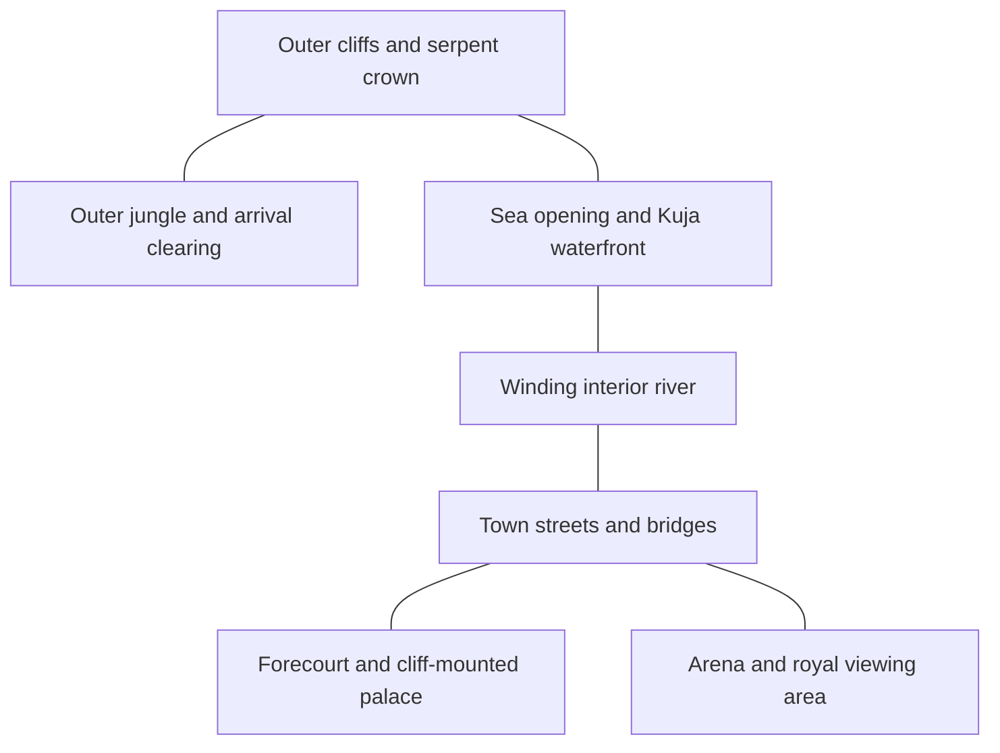

# Amazon Lily: island plan

Prepared 26 October 2026. This document preserves the initial research/design baseline. Implementation began on the same date; see [implementation notes](AMAZON-LILY-IMPLEMENTATION.md) for delivered scope, measurements and remaining reference limits. Sabaody was published separately in commit `51b09c2`.

## 1. Visual direction and historical state

An emerald jungle surrounding a warm limestone mountain, with pale serpent sculptures above its crown. Inside the hollow mountain: a red-roofed town, winding turquoise river, generous palace forecourt and cliff-mounted galleries. Ivory walls, vermilion railings, muted violet roof undersides and restrained gold ornament distinguish the palace from the town. Preserve the project's illustrated-atlas typography and baked diorama lighting.

The physical scene represents intact Amazon Lily during Luffy's first visit, after Hancock's return. Stories can recall different moments in that visit without staging them simultaneously. Luffy arrives through Kuma's power, not aboard a Straw Hat ship. The waterfront vessel is the Kuja flagship, Perfume Yuda. No Sunny, Merry, Polar Tang, Marine invasion, mountain destruction or two-year training camp belongs in this initial physical state. Rusukaina remains a separate island. Later-history entries can be researched separately without changing this reconstruction.

Official narrative basis: [arc overview](https://one-piece.com/story/amazon_lily/index.html), [arrival, episode 408](https://one-piece.com/anime/408/index.html), [Hancock's return, 411](https://one-piece.com/anime/411/index.html), [arena confrontation, 413](https://one-piece.com/anime/413/index.html), [Luffy's choice, 415](https://one-piece.com/anime/415/index.html). Some direct official requests returned 403; indexed official summaries were accessible. Exact future card wording must remain within what its linked source establishes.

## 2. Inspected visual evidence

These are research references, not production textures or reusable model assets. Local copies are in ignored `.tools/amazon-lily-references/`. The hosting pages and fan diagrams are secondary sources; visual observations below come from inspecting the actual images.

| Reference | Observed construction | Confidence / use |
| --- | --- | --- |
| [Outer island panorama](https://opwiki.org/images/Amazon_lily.png) | Orange stratified cliffs, low jungle belt, pale curling serpent forms, large dark-red 九蛇 inscription | Strong exterior silhouette reference; no measured dimensions |
| [Interior aerial](https://api.duniagames.co.id/api/content/upload/file/19209945671687328255.jpg) | Open mountain bowl; compact roof blocks surrounded by usable streets; curving river; large palace forecourt; arched opening toward the sea | Main relative-layout reference; image is a third-party anime repost, not a surveyed map |
| [Palace facade](https://vignette.wikia.nocookie.net/onepiece/images/0/0e/Amazon_Lily_Palace.png/revision/latest?cb=20140928171506) | Tall central tiered hall, paired lower pavilions, upturned roofs, red rails, circular lower windows; galleries on white cliff brackets; rim wall | Strong hero-building reference; keep the central facade and projecting galleries distinct |
| [Exterior/palace composite](https://theonepiecegirl.weebly.com/uploads/2/5/0/2/25029125/1386347183.png) | Confirms the contrast between outer sculpture and inner hanging architecture | Supporting image, lower resolution |
| [Perfume Yuda side view](https://vignette.wikia.nocookie.net/onepiece/images/5/59/Perfume_Yuda_Infobox.png/revision/latest?cb=20141011154758) | Dark curved hull, red framing, gunports, two-storey arched deckhouse, battened red sails, rigging, Kuja insignia, serpent forms at the prow | Strong ship profile; needs a second angle to distinguish hull fittings from the towing animals and confirm their full arrangement |
| [Arena edge detail](https://i.sstatic.net/dVIKF.png) | Pale spectator parapet, exposed rock drop and pointed elements below the ring edge | Partial evidence only; not enough for the entire arena layout |
| [Fan island sketch](https://assets.st-note.com/production/uploads/images/142716572/picture_pc_1c073dcc4df766e5b414294abc044fa2.png?fit=bounds&height=2000&quality=85&width=2000) | Annotates castle, arena and water gate | Secondary orientation aid only; do not copy its measurements or infer exact placement |

[Secondary geography](https://onepiece.fandom.com/wiki/Amazon_Lily) supports the central mountain valley, village and Calm Belt setting. [Architecture commentary](https://www.onepiecepodcast.com/editorial/2015/08/05/chao-time-lady-land) helps identify roof, railing and arena motifs; real-world comparisons are not replacement blueprints. Search captions incorrectly identified other islands' arenas and confused Sandersonia with Hancock. Those captions are not evidence.

### References to resolve before detailed modeling

1. A wide arena frame from episodes 412–415 or corresponding manga: complete seating arrangement, stepped ring, drop, entrances and royal viewing position. Do not substitute the Roman arches/water moat of Dressrosa's Corrida Colosseum.
2. A reverse/three-quarter Perfume Yuda view: two towing Yuda, their connection to the ship, stern fittings, sail faces and docking pose.
3. A close view of the water gate and waterfront: the aerial establishes an opening, but not every door, bridge or pier detail.
4. A street-level village frame for storefronts and everyday roof variation. Secondary houses can be original but must be labelled interpretive.
5. Gloriosa's cottage and the palace throne-room footprint, only if those optional views are added. Neither is a verified interior at this stage.

These gaps do not prevent terrain blockout. They do prevent calling the affected detailed models reference-verified.

## 3. Whole-island composition

Build the empty terrain bowl and water passages first. The town must sit inside the mountain, not on a flat disk in front of a solid cone. Both exterior serpent silhouette and interior city need readable overview cameras. Keep the foreground mountain intact; use deliberate elevated approaches over the rim instead of hiding terrain whenever it blocks a view.

This is an adjacency diagram, not a canonical orientation map. The inspected aerial controls which masses surround the city. The arena's exact sector remains provisional until its wide reference is checked.

### Proposed authoring frame

Use Y-up and sea level Y=0; X/Z are model-space axes, not asserted compass directions. The inscription faces the +Z approach. Proposed working dimensions, all artistic compression:

| Zone | Provisional footprint / height | Placement intent |
| --- | --- | --- |
| Outer island | Approximately 540 × 500 units | Irregular coast and jungle apron; no uniform circular slab |
| Mountain bowl | Approximately 360 × 330; rim Y=110–180 | Broad usable interior, varied rock buttresses and an open sky |
| Serpent crown | Up to Y=250–270 | Full curving necks, distinct heads and open negative spaces; determine exact arrangement from the panorama |
| Village | Approximately 190 × 150; terraces Y=8–24 | Several roof clusters, crossings and open lanes; preserve the river corridor |
| Palace | Back-left inner wall, roughly X=-65, Z=-75; Y=35–115 | Tiered central hall plus lateral supported galleries and large forecourt |
| Arena | Provisional opposite interior sector, radius 38–45 | Separate ring, seating and drop; keep a clear focused-camera approach |
| Sea opening | Back-right sector, roughly X=100, Z=-135 | Connect the visible exterior inlet with the interior waterway |
| Kuja mooring | Outside that opening, roughly X=175, Z=-220 | Space for hull, sails and both Yuda; size only after full ship bounds exist |

A 3-unit doorway is the initial scale anchor. Railings are about 1.1 units high; ordinary storeys 4–5 units. The ship should read as a substantial multi-deck vessel, not a toy hidden by the pier. These values are starting ratios, not claimed canon dimensions.

Keep interior water at the same level as the connected inlet unless a reference demonstrates a height change. Carve its bed below that level; bridges span its real width. Do not invent a waterfall merely to hide inconsistent terrain elevations.

## 4. Landmark and story plan

Target twelve useful views. Split a building into multiple views only when the framing or story genuinely changes.

| # | View | Required visual subject | Narrative / evidence |
| --- | --- | --- | --- |
| 1 | Calm Belt approach | Full shoreline, mountain and readable crown | Geographic setting; exterior panorama |
| 2 | Kuja monument | Serpent heads, arching necks, 九蛇 rock inscription | Island identity; no invented historical event |
| 3 | Jungle arrival clearing | Layered broadleaf trees, rooted ground, a readable small clearing | Luffy's landing, [408](https://one-piece.com/anime/408/index.html); clearing footprint interpretive |
| 4 | Village entrance | Path threshold, supported gate/roof details | Luffy's encounter with the Kuja, [409](https://one-piece.com/anime/409/index.html); entrance details need a street reference |
| 5 | River and bridges | Carved riverbanks, two distinct crossings and clear water | Geographic view based on the aerial |
| 6 | Kuja streets | Varied roofs, lattice windows, lanterns and small shop fronts | Everyday setting; original secondary architecture |
| 7 | Kuja Castle | Entire tiered facade, side pavilions, cliff supports and forecourt | Hancock's return and authority, [411](https://one-piece.com/anime/411/index.html) |
| 8 | Cliff galleries | Supported walkways, red rails, overhanging roof profiles | Architectural close-up; no unverified room event |
| 9 | Arena overview | Full arena footprint and access route | Confrontation, [413](https://one-piece.com/anime/413/index.html); wide visual reference still required |
| 10 | Fighting platform | Ring, parapet and its actual drop visible above the story panel | Luffy protects Sandersonia and asks for the others' restoration, [415](https://one-piece.com/anime/415/index.html) |
| 11 | Kuja waterfront and ship | Complete Perfume Yuda, both towing serpents, water gate and mooring | Return/departure setting; [411](https://one-piece.com/anime/411/index.html), [417](https://one-piece.com/anime/417/index.html) |
| 12 | Inner-valley overlook | Palace, town, winding river and mountain rim together | Closing geographic view; route onward mentioned without spawning another island |

Optional after reference verification: Gloriosa's outskirts cottage and an empty palace audience-room cutaway. A bath scene is not required. No character animation, crowd simulation or playable combat is part of this first model.

## 5. Detail and motion design

- **Mountain:** layered warm rock, asymmetric buttresses, sculpted serpent heads with real mouths and eyes, moss on ledges; preserve gaps between necks. Avoid a bundle of identical tubes or nine identical spheres.
- **Lettering:** verify the 九蛇 glyphs and their orientation against the panorama. Helvetiker lacks Japanese glyphs; use original vector outlines or a verified licensed CJK font subset, not missing-character squares or an enormous whole font. Keep the inscription attached to the curved rock with depth clearance.
- **Palace:** upturned tiled eaves, roof ridges, snake ornaments where visible, bracket rhythm, red columns, white plinths, violet/blue trim and circular lower windows. Side galleries visibly connect to the cliff.
- **Town:** three or four building families and several heights; streets and riverside space remain visible from phone cameras. A handful of readable market props carries detail more efficiently than hundreds of isolated meshes.
- **Jungle:** clustered canopy, palms and broadleaf forms with sparse vines; preplanned sightlines around arrival and the rim. Keep foliage from taking most of the lighting atlas.
- **Ship:** curved dark hull, red structural trim, gunport rhythm, arched deckhouse, sail battens, rigging and correctly oriented insignia. Hull and Yuda must have separate authored bounds, even if their moored pose remains static.
- **Calm Belt:** a dedicated quiet-water profile, restrained shoreline motion and almost still sails. Do not inherit Water 7 storm behavior or add constant strong wind. Start with a bounded vertical ship bob, maximum about ±0.06 units, and no lateral drift. Any later Yuda motion requires swept-volume checks for both animals and their attachments.
- **Ambient life:** at most 8 distant birds and 24 small local particles, instanced. No mandatory full-screen mist, expensive transmission or automatic weather spectacle. Reduced motion freezes ambient motion in valid poses.

## 6. Camera, phone layout and integration

Use `MeasuredIslandCamera` and a future `amazon-lily-layout.json` for model, marker, water and vessel coordinates. Phone offsets must be authored separately wherever the mountain rim or canopy blocks the subject. Fit complete ship sails and serpent crowns from measured geometry, not a hand-picked center point.

Journey: exterior approach → jungle edge → high reveal over a verified rim gap → river/town → palace → arena → waterfront → interior overlook. Use generous curved transitions; no travel through cliff walls. Inspect intermediate positions as well as stop endpoints. A direct focus move between two interior stops must stay within the bowl or rise above the intervening terrain.

Prototype the longest titles, palace silhouette, arena drop and ship view on 390×740 and 320×568 during blockout. Retain full story actions without nested scroll, 44px touch targets and the existing measured dock/header spacing. Also check 360×640, 844×390 and 1440×900, enlarged text and normal/reduced motion.

The existing atlas location is `amazon`; it stays informational during planning. Only connect it to a future `amazon-lily` scene after that asset works. Keep atlas-first entry, brand return, scene-only loading transitions, preserved journey progress on Return/Escape/reverse-wheel/downward swipe, and failure recovery. Existing islands retain their current behavior.

## 7. Performance targets and asset pipeline

These are targets only. There is no Amazon Lily model to measure yet.

| Budget | Proposed target |
| --- | --- |
| Static model including ship | 150k–210k triangles |
| Terrain + serpent sculpture allocation | 45k–60k triangles |
| Palace + town allocation | 45k–60k triangles |
| Arena + gates + bridges | 20k–25k triangles |
| Forest + ship + props | 40k–65k triangles |
| Spatial/visibility batches | 50–80 |
| Baked GLB download | 10–15 MiB |
| Lighting texture | One 4096px atlas; RGBA+mips estimate 85.3 MiB decoded, not total GPU memory |
| Balanced desktop whole-frame planning goal | Typically under 100 calls in reviewed stops; measure depth passes too |

Keep bounded moving objects out of the static water-depth cache. Group the cliff, canopy and town by spatial sectors; separate any later optional interior shells. Bake static diffuse lighting with Cycles, retain split corner normals through welding and use explicit UV margins. Weight atlas space toward palace details, the inscription and ship insignia; confirm actual close-up readability before increasing texture size. Runtime stays unlit for the static island. Balanced quality and reduced motion are first-class paths.

Record actual GLB bytes, triangles, batches, texture memory estimates and full-frame samples after the final model exists. Do not describe the targets as achieved or promise phone FPS from desktop emulation.

## 8. Implementation order and review gates

1. Resolve the arena, gate and ship-angle references; record visible features and remaining interpretations.
2. Author terrain bowl, rim, sculpture silhouette, connected water domain, district footprints and rough ship envelope. Review exterior and interior compositions on desktop and phone before detail.
3. Add palace, arena and ship hero geometry. Inspect each facade and complete bounds; correct scale before surrounding town/forest details.
4. Add varied town roofs, galleries, bridge supports, jungle and limited props. Check every landmark and travel corridor for clipping/occlusion.
5. Bake and inspect lettering, roof edges, curved heads, shadow seams and texture density. Measure asset and rendering costs.
6. Integrate twelve stories and the atlas entry, then verify card fit, scene-only loaders, all return paths, missing asset recovery, cached re-entry and cross-island context.
7. Visually review every final landmark at 1440×900 and 390×740; check small-phone/landscape extremes and normal-motion travel. Test actual phone hardware when available and record any remaining device limitations.

The initial plan is retained as a baseline. Current implementation and unresolved references are recorded in the implementation notes; optional interiors remain outside the delivered scope.
