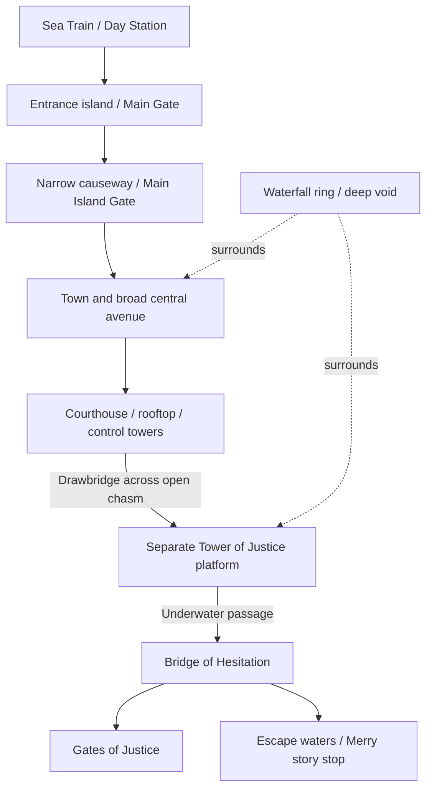

# Enies Lobby — model and experience plan

Prepared 21 October 2026; implementation added 22 October 2026. This document preserves the original proposal. See [implementation and verification](ENIES-LOBBY-IMPLEMENTATION.md) for what shipped locally, measured budgets and remaining scope. Water 7 boat/sign fixes were pushed separately as `58765b9`.

## 1. Direction

Build a spacious judicial stronghold around a visibly deep waterfall chasm. The defining composition is the sequence of separated landmasses, the courthouse facing the Tower of Justice, and the enormous Gates of Justice beyond. Keep the illustrated atlas identity established in [art direction](ART-DIRECTION.md), with white masonry, green panels, restrained gold edging, warm town buildings, blue water and bright daylight.

Use an intact, rescue-era architectural reconstruction as the default. Story stops explain the assault and escape; they do not imply every event happens simultaneously. The Merry appears at the escape stop, rather than sitting at the station throughout. Any later damaged-state variant is a separate milestone. Do not invent a present-day rebuilt Enies Lobby.

Inherited mobile and navigation requirements supersede the older desktop-only wording in the art direction. Technical baseline: [original specification](original-spec.md), [Water 7 implementation](WATER-7-IMPLEMENTATION.md), and [Water 7 planning lessons](WATER-7-PLAN.md).

## 2. Reference findings and limits

### Geography established by the references

Enies Lobby has a station approach and two entrance gates, a town and courthouse, then a separate Tower of Justice across a drawbridge. The courthouse has bridge-control towers. An underwater passage connects the tower side to the Bridge of Hesitation, which leads toward the Gates of Justice. These connections, the waterfall ring and perpetual daylight determine the layout. They do not establish a survey with exact distances or bearings. [Location reference](https://onepiece.fandom.com/wiki/Enies_Lobby)

### Visual references inspected for this plan

| Reference | Use | Limits |
| --- | --- | --- |
| [Annotated overview hosted by OPwiki](https://opwiki.org/images/Enies_Lobby_karte2.JPG) | Separate entrance, main island and tower platform; broad town axis; large empty chasm around them | Schematic with added labels. Do not copy its compressed scale or interpret perspective as stacked floors. |
| [Tower still posted by OnePieceAnime](https://pbs.twimg.com/media/EC6wBTiXkAQFDWK.jpg), [source post](https://x.com/OnePieceAnime/status/1166062900794077191) | Stepped white facade, green inset panels, arched openings, balconies, roof flag and integrated ENIES LOBBY lettering | One front view; rear and internal structure need additional references before detailed modeling. |
| [Enies Lobby Gates still](https://vignette.wikia.nocookie.net/onepiece/images/4/4d/Enies_Lobby%27s_Gate_of_Justice.png/revision/latest?cb=20160307220939&path-prefix=pt) | Curved gate silhouette, central seam, rivets, Government emblem, tower-to-gate scale contrast | Anime still hosted by a third party; perspective prevents exact dimensional measurement. |
| [Bridge cross-section panel](https://pbs.twimg.com/media/GOtP1pFbkAAjchY.jpg), [source post](https://x.com/hamaboh_manga/status/1795616665230787048) | Underwater approach, bridge supports and hinged continuation through the gate | Reposted colored panel; use for relationships, not an exact engineering drawing or shipped texture. |

These images are reference material, not site assets. All geometry and textures should be authored for this project. Inspect the actual image: search-engine image descriptions misidentify buildings and characters and must not supply modeling facts.

### Narrative reference anchors

- Arrival and assault: [official episode 263](https://one-piece.com/anime/263/index.html), [264](https://one-piece.com/anime/264/index.html).
- Courthouse rooftop and gathering: [official episode 272](https://one-piece.com/anime/272/index.html).
- Robin's decision: [official episode 278](https://one-piece.com/anime/278/index.html).
- Flooded passage: [official episode 306](https://one-piece.com/anime/306/index.html).
- Escape sequence: [official episodes 310](https://one-piece.com/anime/310/index.html) and [episode directory including 311–312](https://one-piece.com/anime/index.html?category=&page=13&sort=asc).

Official indexed summaries were readable; direct requests to several official pages returned 403. The official story grouping spans episodes 264–325, including later events away from the island. Do not assign that whole range to every landmark or place the Merry farewell on the island. Verify each final story's episode label individually. [Official story index](https://one-piece.com/story/index.html)

Before detailed modeling, collect front/side views for the courthouse, both entrance gates, Day Station, bridge towers and tunnel exits. Their exact window counts, roof detailing and interior floor plans remain unresolved; the plan does not pretend otherwise.

## 3. Proposed layout and proportions

**The following dimensions are original authoring proposals, not canonical measurements.** Use Y up, sea at Y=0, approach along +Z, Gates toward −Z. Preserve adjacency first, then tune distances from overview and phone screenshots.

| Mass or zone | Proposed center / extent in authoring units | Composition requirement |
| --- | --- | --- |
| Chasm | Center (0,0,0); radius about 180; visible depth 100–140 | Maintain continuous visible gaps around the main island. The bottom disappears into darkness and mist. |
| Entrance island | Center (0,8,225); roughly 85 wide × 75 long | Station and fortified gate read independently. Rail approach continues toward +Z. |
| Causeway | Z 65–190; 12–18 wide | Thin connection across the void; it must not fill the chasm. |
| Main island | Center (0,18,0); about 130 wide × 150 long | Irregular rock underside, long avenue, varied town blocks and generous courthouse forecourt. |
| Courthouse | Center (0,32,−50); 65 wide × 35 deep, rooftop around Y=48 | Broad, low silhouette; rooftop remains a useful stage facing the tower. |
| Tower platform | Center (0,18,−145); about 60 wide × 50 deep | Clearly separate rock base. Keep roughly 50 units of open separation from the courthouse land edge. |
| Tower of Justice | Center (0,65,−145); about 44 wide × 36 deep, roof near Y=115 | Distinct stepped facade, wings and balcony hierarchy; visible from the courthouse. |
| Passage exit and bridge | Z roughly −245 to −360 | Passage runs below water; surface bridge has visible support towers and its own camera composition. |
| Gates of Justice | Plane near Z=−360; start around 300 wide × 280 high | Monumental background mass, several times the tower height; adjust against the inspected still. |
| Escape water | Offset to one side of the bridge, initially X≈60, Z≈−285 | Reserve a navigable surface for the Merry, separated from supports and the waterfall drop. |

The coordinate system is a working convention, not a claim about compass north. The overview may compress the length of the offshore route, but must retain the separation between courthouse, tower and gates. Town density should come from grouped buildings, streets and roof variation, rather than filling every empty patch.

## 4. Model inventory and fourteen planned stops

All stops get their own bounds and approach direction. Shared buildings can support two story views without duplicating meshes. Names below are navigation labels; final story wording follows source verification.

| Stop | Required model detail | Camera and readability gate |
| --- | --- | --- |
| 01 — Day Station | Covered platform, track termination, station frontage, rails and landing | Approach along the rail; show platform/track separation. Station-specific roof reference required. |
| 02 — Main Gate | Broad fortified entrance, rounded side elements, green panels, crenellations and flags | Three-quarter front view with enough ground to read the entry. |
| 03 — Main Island Gate | Second, distinct gate and narrow causeway | Show both the crossing and the drop beneath it; avoid a camera inside the arch. |
| 04 — Judicial town | Warm low-rise buildings, taller accents, side lanes and central avenue | Elevated oblique view with courthouse visible at the far end. |
| 05 — Courthouse | Wide facade, central arch, green roof/wall treatment, corner details and forecourt | Front view; preserve width and surrounding plaza. No tower-like proportions. |
| 06 — Courthouse rooftop | Parapet, open roof surface, flag details and tower-facing edge | Compose rooftop foreground against the distant tower. Keep the intervening gap visible. |
| 07 — Drawbridge controls | Paired control towers, bridge hinge and deck | Side view shows how the deck connects the landmasses. No unsupported floating segment. |
| 08 — Waterfall chasm | Rock undersides, waterfall rim, vertical flow, abyss gradient and sparse mist | Wide environmental view demonstrating depth; never render a sea surface across the void. |
| 09 — Tower of Justice | Stepped massing, balconies, green/gold panels, windows and attached lettering | Three-quarter front view; integrated signage clear of other geometry. |
| 10 — Robin's balcony | Upper balcony, railings, flagpole and facade framing | Separate tighter view; the courthouse stays contextually visible. No character model dependency. |
| 11 — Underground passage | Entrance/exit structures, stair transition and marked below-water route | Focus the visible exit. An optional cutaway would be a later asset, not a camera pushed through walls. |
| 12 — Bridge of Hesitation | Supported spans, cylindrical towers, parapets, hinged section and landing | Lateral view showing bridge length and relative height above water. |
| 13 — Gates of Justice | Two thick leaves, center seam, curved outline, emblem and large-scale rivet rhythm | Low oblique reveal; the tower remains a small scale cue. Overview fit and close-up fit are separate. |
| 14 — Escape waters | Correctly sized Merry, bridge context and distant ship silhouettes where justified | Waterline view with a safe hull envelope, away from supports and the chasm. |

CP9 encounters belong to the tower's story content. Detailed rooms, combat characters, a walkable tunnel, destructive physics and a full Buster Call fleet are later options, not hidden requirements for the first exterior model. If interiors are commissioned, create a small referenced cutaway set with its own budget and cameras.

## 5. Modeling and animation rules

1. **Block out the entire geography first.** Produce top, side, approach and courthouse-to-tower views. Check the gate scale before adding windows or town repetition.
2. **Hero silhouettes before ornament.** Model the courthouse, tower and Gates separately. Compare each with its reference at thumbnail size and in a close-up. Generic boxes with labels are not sufficient.
3. **Separate structure from movement.** Bake land, buildings and fixed bridge supports. Keep flags, moving bridge leaves, water, train and ships outside the static bake and ocean depth cache.
4. **Water has explicit domains.** Ocean outside the waterfall boundary; radial rim foam and falling water around the hole; dark interior and low-cost mist below. Use the same mask for color and depth passes, including the entrance causeway. Reusing a full ocean plane would cover the abyss.
5. **Ships have surface and clearance checks.** Author the waterline, full hull bounds and swept motion envelope. Check every buoyancy/drift extreme against bridge supports, shore and waterfall edge. Keep the Merry's atlas interaction aligned to its actual model position.
6. **Train movement is optional ambient detail.** If included, use the established per-car arc-length placement and couplings. Check every carriage through bends; hide resets beyond the visible approach. Rocketman's assault arrival is a distinct story moment, not a generic looping commuter train.
7. **Signs belong to architecture.** Give lettering a real backing or facade plane; test against slopes, balconies, nearby roofs and the selected camera. No z-fighting or floating billboard text.
8. **Controlled motion only.** Water flow, modest flag motion and restrained clouds. Reduced motion freezes ambient travel and gives immediate focus changes. Avoid a night toggle for this setting.

## 6. Camera, UI and mobile requirements carried forward

- Reuse the shared island configuration and one authored layout source for model anchors, marker positions, camera bounds, rail paths and clearances. Avoid separate hardcoded coordinates drifting apart.
- Camera journey: rail arrival → gate/causeway → town → courthouse roof → tower reveal → bridge → Gates → escape overview. Use a curved route with intentional hold lengths, not constant movement through every stop.
- Each selected view fits the landmark's bounds inside the **actual unoccupied viewport rectangle**. Measure the header, story card, bottom dock and safe-area insets. Use a facade-specific approach; do not apply one offset to all buildings.
- On phones, keep the scene above the bottom story card. At 360×640 and 390×740, every core stop must show its identifying silhouette and all card actions. Gates can have a deliberate detail crop only when a full-scale overview is also provided.
- Cards have no nested scrolling. Shorten narrative copy and group actions before reducing type size. At enlarged text or unusually short landscape heights, use a single accessible document flow that can scroll rather than clipping content or creating an inner scrollbar.
- Keep touch targets at least 44 CSS pixels. Respect dynamic browser height and safe areas; test the expanded and collapsed mobile address bar states.
- Hide scene pins during mobile intro and focused stories. In free exploration, prevent pins from overlapping the header/controls; the landmark dock remains an accessible alternative.
- Preserve the exact saved journey position on Return, Escape, reverse wheel and downward swipe. Scrolling within selectable text or UI must not unexpectedly move the camera.
- World map opens first; brand returns to it. Explore labels appear on hover/focus; touch can activate pins directly. Keep existing atlas zoom clarity.
- Sea/cloud travel loader only for initial loading and real island/map scene changes. No loader for landmark focus, bridge animation, settings, or returning to the journey.
- Preserve Alabasta and Water 7 behavior, missing-model recovery, keyboard navigation and reduced motion. Do not silently change global styling to fit the new island.

## 7. Performance plan — targets to measure, not promises

Water 7's current static model is 132,016 triangles, 54 district meshes and 10.16 MiB. That is a useful baseline, not proof of performance on a physical phone. Enies Lobby's longer sightlines and transparent waterfall may cost more even with fewer triangles.

| Area | Initial target / method |
| --- | --- |
| Static geometry | Aim for 140k–180k triangles; review before exceeding 200k. Reserve detail for the tower, courthouse and Gates; simplify distant roofs and unseen backs. |
| Payload | Aim for 8–12 MiB for the island's static model and baked textures combined. Record transfer and decoded GPU costs separately. |
| Lighting/textures | Cycles diffuse/AO bake and unlit runtime materials, following the existing pipeline. Start with one shared 4096px atlas; offer a smaller tier only if it remains legible. A 4096 RGBA texture with mipmaps is about 85 MiB decoded without GPU compression. |
| Draw calls | Initial target: at most 100 calls in the main scene render for a typical view. Measure the whole frame separately because depth and post-processing add passes. |
| Batching | Spatial batches for entrance, town, courthouse, tower, bridge and gate precincts. Instance repeated windows, railings and houses; keep culling useful. |
| Large gate | Real geometry for silhouette, seam and major emblem; bake small rivets and panel lines. No thousands of independent bolt meshes. |
| Waterfall/particles | A few segmented ribbon meshes and shader flow, limited transparent overlap; pooled mist with a fixed cap, initially 64 instances. Profile fill rate on phones. |
| Quality tiers | Balanced remains default. Cap phone DPR initially at 1.5; disable costly optional effects before sacrificing silhouette or text clarity. |
| Lifecycle | Load the island on entry, pause hidden animation, keep static depth cached and invalidate it deliberately after scene/geometry changes. Dispose owned temporary resources; retain only intentional cache entries. |
| Frame time | Aim for 60 fps on the test desktop and stable 30 fps on the chosen midrange physical phone. Publish measured devices and frame-time percentiles; browser emulation alone cannot prove phone performance. |

If the first profile misses the target, reduce water overdraw and optional effects, simplify distant detail, then consider district streaming/LOD. Do not add streaming complexity before a measurement demonstrates the need. Preserve the enormous gate silhouette even at the lowest detail tier.

## 8. Build milestones and acceptance gates

| Phase | Deliverable | Must pass before advancing |
| --- | --- | --- |
| A — Reference closure | Reference board for unresolved facades, small source ledger, finalized adjacency diagram | Every hero model has a usable silhouette reference; unknown dimensions are marked as authoring choices. |
| B — Complete blockout | Full separated landmasses, chasm, courthouse, tower, gates and fourteen camera placeholders | Overview reads immediately; courthouse/tower never merge; no compact pile of buildings. Check desktop and phone before detail work. |
| C — Hero models | Gateways, courthouse, tower, bridge and Gates with key ornament | Front/side comparisons and all planned focus views; signs legible and attached. |
| D — City and water | Town blocks, terrain underside, causeway, shader chasm and small props | Negative space remains; no sea plane over abyss, geometry intersections or camera-through-wall paths. |
| E — Bake and optimize | Production GLB, atlas, measured mesh/payload budget, quality settings | All-in frame profile and decoded texture estimate recorded; visual readability survives optimization. |
| F — Shared experience | Verified story copy, atlas entry, camera route, mobile layout and limited motion | Same navigation rules as existing islands, with zero nested story-card scroll and no accidental loaders. |
| G — Final review | Desktop/phone captures of every stop plus geometry and regression results | Full journey and each landmark approved by evidence, not only a passing build. |

Verification checklist for implementation:

- Test all fourteen stops at 1440×900, 390×740, 360×640, 320×568 and 844×390; add one real Android and one real iOS browser when available.
- Inspect screenshots after camera transitions settle. Run reduced-motion captures for deterministic framing, then separately verify normal travel/return motion.
- Check intro, free exploration, focused stories, dock scrolling, keyboard focus, 200% text, safe areas and browser-toolbar height changes.
- Sweep full boat and train animation envelopes; test surface height, hull/shore clearance, couplings and bridge pivots geometrically, then confirm the rendered view.
- Sample the whole camera path for near-plane clipping, oversized signs, obstructing roofs and marker collisions.
- Switch map → Alabasta → Water 7 → Enies Lobby repeatedly; inspect memory trends and duplicate listeners. Test a failed model request and WebGL context recovery separately.
- Re-run existing island regressions and production build. Report actual device/performance limits rather than claiming an unmeasured optimization pass.

**Implementation status:** the exterior island and fourteen stops are now built. Follow the implementation notes for the actual asset, tests and limitations; proposed optional features and hardware targets above are not completion claims.
