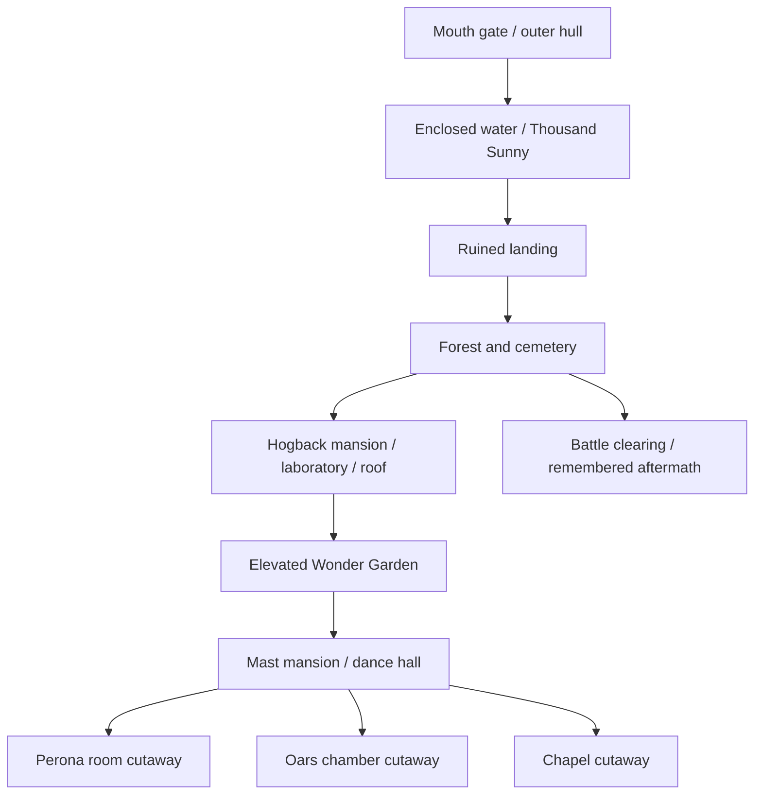

# Thriller Bark — build plan

Prepared 24 October 2026; detail expansion requested 25 October 2026. Implementation authorized after the research request. This plan defines the next exterior island and selected room cutaways; completion and actual measurements belong in separate implementation notes.

## Direction and historical state

A vast haunted ship with a mouth gate, visible ring of water, ruined inner fortifications, a forest, a cathedral-like mansion and a separate cylindrical mast mansion. Its three masts, four heavy chains, weathered sails and bat/skull emblem must read in the overview. Use lavender stone, slate roofs, aged timber, moss and restrained amber windows. The scene is moonlit and fogbound, but architecture must remain readable on a phone.

Use intact arrival-era architecture. The Thousand Sunny is the visiting ship. The Going Merry must not appear here. Later battles and dawn are remembered in story text; they do not silently destroy buildings or change the historical setting. A clearer-view control reduces mist for visibility, rather than claiming permanent night or a simultaneous dawn battle.

## Inspected evidence

Research copies are stored under ignored `.tools/thriller-bark-references/`; they are not production textures.

| Reference | Visible evidence / use |
| --- | --- |
| [Whole ship](https://pbs.twimg.com/media/GCgeu3LbAAAwr3d.jpg) | Mouth-shaped bow, water annulus, inner wall, three masts, lettered side sails, central emblem and four chains. Reposted anime still; dimensions are not surveyed. |
| [Arrival, episode 339](https://www.imdb.com/title/tt1171047/mediaindex/) | Sunny inside the outer enclosure, water gap and ruined inner frontage; retrieved still inspected locally. |
| [Hogback exterior](https://opwiki.org/images/Hogback_Schlossa.jpg) | Broad gothic facade, tall central doorway, repeated windows, peaked corner towers and foreground vegetation. |
| [Mast mansion](https://opwiki.org/images/Mastvilla.jpg), [facade detail](https://opwiki.org/images/Morias_Mast_Villa_.PNG) | Cylindrical building, circular and arched windows, skirt roof, balconies, red drapery and elevated side connections. |
| [Laboratory](https://opwiki.org/images/HS_Labor.jpg) | Stone room, operating table, equipment, hanging coffins and upper stairs. |
| [Wonder Garden](https://opwiki.org/images/PeronaWundergarten.jpg) | Trees, incongruous doors, green arch and glowing round ornaments. |
| [Perona's room](https://opwiki.org/images/Peronas_Zimmer_1.jpg) | Pale/gold framing, curtains, canopy bed, purple seating and toy motifs. |
| [Oars chamber, licensed episode thumbnail](https://abema.tv/video/episode/5-38_s15_p350) | Icy walls, giant horned figure, restraints and elevated observation railing. |
| [Chapel, episode 358 still](https://www.imdb.com/title/tt1245592/) | Red aisle, pews, candles, altar and paired organ pipes. |
| [Forest](https://opwiki.org/images/Thrillerwald2.jpg), [cemetery](https://opwiki.org/images/TB_Friedhof.jpg) | Twisted vegetation, gravestones and broken stonework. |

The [official arc summary](https://one-piece.com/story/thriller_bark/index.html) establishes the shadow rescue, Oars battle, Kuma encounter and Brook's decision. The [secondary location reference](https://onepiece.fandom.com/wiki/Thriller_Bark) establishes named building relationships. Search image captions were unreliable: an alleged garden download was an unavailable-image placeholder and was rejected. Actual inspected images govern modeling.

Exact room footprints, rear elevations, individual window counts and compass bearings remain unknown. Model those as original interpretations. A selected cutaway is a viewing aid, not a claim that the building has no roof.

## Layout and scale

All coordinates are authoring proposals, Y up, sea at zero, approach from +Z. Preserve large gaps before ornament.

| Element | Proposed extent / position | Acceptance |
| --- | --- | --- |
| Outer hull | Radius 160, height 14, thickness 6 | Ship construction, mouth opening, waterline and continuous rim visible. |
| Inner land | About 200 × 184, top Y=10 | Wide water annulus; no filled bay or forest covering every landmark. |
| Mouth gate | +Z edge, roughly 50 wide | Lips and teeth form a recognizable entrance. |
| Hogback mansion | Center (0,10,22), about 60 × 34 | Broad front, distinct roofs/towers and readable entrance. |
| Mast mansion | Center (0,10,-50), main radius 18, height about 90 | Cylindrical silhouette and balconies; separate from the mansion. |
| Wonder Garden | Between the buildings, elevated around Y=25 | Genuine supported connection with trees and doors, visible gap below. |
| Side masts / main mast | Side X≈±140; main above mast mansion | Sails do not hide every view. Full ship overview includes mast tops. |
| Sunny | Approximately (45,0,116) | Full hull and animation envelope clear of both walls and land. |
| Cemetery / forest / clearing | Separate sectors around the mansion | Preserve traversable lanes and reserved camera corridors. |

## Sixteen planned viewpoints

1. Mouth gate — enclosing ship and entry; [episode 339](https://one-piece.com/anime/339/index.html).
2. Thousand Sunny — arrival anchorage; episode 339. New lion-prowed model, not a recolored Merry.
3. Ruined landing — breached wall and Mini Merry landing context; [episode 340](https://one-piece.com/anime/340/index.html).
4. Haunted forest — winding carriage route; episode 340.
5. Cemetery — gravestones and mausoleum; historical setting, official arc reference.
6. Hogback mansion — distinctive full facade; episode 340.
7. Laboratory — furnished roof cutaway; [episode 342](https://one-piece.com/anime/342/index.html).
8. Wonder Garden — elevated forest/door garden; [episode 345](https://one-piece.com/anime/345/index.html).
9. Perona's room — furnished cutaway; [episode 361](https://one-piece.com/anime/361/index.html).
10. Oars chamber — ice, restraints and a static stylized giant; [episode 350](https://one-piece.com/anime/350/index.html).
11. Chapel — aisle/pews/organ cutaway; [episode 358](https://one-piece.com/anime/358/index.html).
12. Mast mansion — tower, clock-like wheel and balcony; historical setting.
13. Laboratory rooftop — Zoro/Ryuma encounter, intact roof viewpoint; [episode 362](https://one-piece.com/anime/362/index.html).
14. Battle clearing — Oars and dawn remembered; [episode 374](https://one-piece.com/anime/374/index.html).
15. Quiet aftermath — Kuma/Zoro story at an illustrative clearing; [episode 377](https://one-piece.com/anime/377/index.html). Do not claim a surveyed event coordinate.
16. Departure overlook — Brook, Laboon and returning to sea; [official arc summary](https://one-piece.com/story/thriller_bark/index.html), [episode 380](https://one-piece.com/anime/380/index.html). No copyrighted song recording bundled.

Descriptions stay short enough for complete phone cards. Rooms get separate shell/interior batches so their cutaways reveal authored furnishings without moving the camera through opaque walls. No combat simulation or walkable full interior is implied.

## Build sequence and integration

1. Shared layout file and complete geography blockout; inspect ship silhouette and water annulus on desktop/phone.
2. Distinct mansion, mast, chains, sail profiles, gate and Sunny, followed by forest, graves and secondary structures.
3. Furnished laboratory, Perona, freezer and chapel cutaways. Restore roofs automatically when leaving their stories.
4. Cycles atlas bake preserving authored normals; retain spatial batches and independent shell/interior/ship groups. Review normals, tiny relief depth and text support.
5. Shared atlas registry entry for existing place ID `thriller`; separate scene ID `thriller-bark`. Reuse shared UI and measured camera framing. Scope fog/palette changes to this island.
6. Sweep every focus view, normal camera journey, reduced motion, model failure and cross-island navigation. Document actual budgets separately from targets.

## Performance targets and validation gates

Target 100k–160k static triangles, 8–12 MiB GLB, one 4096px shared atlas (about 85 MiB decoded RGBA with mipmaps), and 40–70 useful batches. Targets may be adjusted from measurements; do not add geometry just to reach them. Repeated trees, tombstones and chain links use shared geometry or merged spatial batches. Keep mist to a few bounded shader surfaces; no full-screen volumetric raymarch or hundreds of transparent particles. Balanced quality remains default.

Check cold/cached entry, hidden-scene pause and disposal. The moving Sunny is excluded from the cached static water-depth pass. The island remains anchored so pins, water and bridges do not drift apart. Check active shader uniforms after default camera changes.

Review all sixteen views at desktop and phone sizes. Automate 1440×900, 390×740, 360×640, 320×568 and 844×390. Measure actual header/card/dock rectangles. No inner phone card scroll, no long-label overlap, no pins over intro/stories, and no atmospheric effects obscuring text. Return/Escape/reverse wheel/downward swipe preserve journey progress. Only scene navigation invokes the voyage loader.

Physical-phone FPS, browser chrome/safe-area behavior, 200% text and GPU context recovery require their own verification; passing browser emulation is not a hardware result. Inspect every final landmark, including the secondary forest, landing and cemetery views.

## Detail pass — 25 October

Implementation includes larger bowed sails with front/back faces, torn hems, seams, repair patches, curved lettering and an original horned bat/skull relief. Added rigging, crow’s nests, ladders and pennants; enriched roots/canopies, aged graves, wall ivy, masonry, landing supplies and Sunny fittings. Five instanced ambient bats accompany the mist and moored ship. The [implementation notes](THRILLER-BARK-IMPLEMENTATION.md) contain final scope, measurements and verification.
