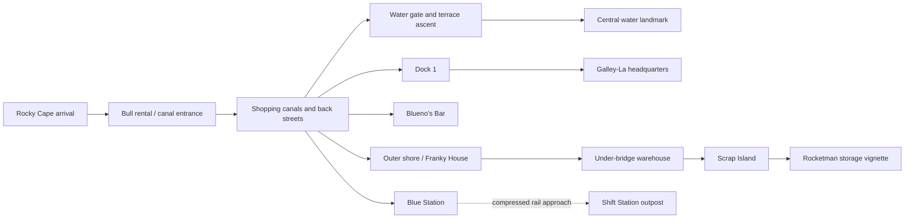

# Water 7 — research and implementation plan

Prepared 18 October 2026. **Original planning brief.** Water 7 has since been implemented; see [implementation status, measurements and remaining limits](WATER-7-IMPLEMENTATION.md). The targets below are retained as the original proposal, not a statement that every device/performance gate has passed.

The existing mobile fixes were pushed to `main` as `29b02f3`. This document is the proposed next-island brief, not a promise that its performance targets have already been achieved.

## 1. Scope and inherited requirements

Build a recognizable, explorable Water 7 city with the same illustrated atlas identity and interaction model as Alabasta. Plan for desktop and phones together. The complete city silhouette should communicate scale; close-up detail should concentrate around the locations visitors can actually inspect.

Preserve these user requirements without asking for them again:

- World map opens first. Its Water 7 pin/search entry enters Water 7; Alabasta continues to enter Alabasta. The brand returns to the world map.
- Sea/cloud/ship loading animation only for initial loading and actual scene changes. No loader for landmark selection, returning to the journey, search, settings, or weather.
- Explore labels appear on hover or keyboard focus, not permanently. Touch users can tap a pin directly and use the searchable directory.
- Landmark focus interrupts the scroll route. Return, Escape, reverse wheel, and downward swipe restore the previous journey pose/progress without resetting the island.
- Story cards have deliberate padding, readable type, consistent actions, and **no nested scrolling**. All content and actions must fit at the supported default phone sizes.
- Markers must never cover introductory copy, headers, story cards, or controls. Keep the current phone rule: hide scene markers during the intro and selected stories.
- Preserve crisp atlas zoom, keyboard access, reduced motion, map/model error recovery, and existing Alabasta behavior.

The [original specification](../docs/original-spec.md) supplies the rendering and navigation blueprint. Current implementation decisions are documented in [README](../README.md). Some older prose in [ART-DIRECTION](./ART-DIRECTION.md) describes an earlier desktop-only, pre-timeskip milestone; the newer user requirements above take precedence.

## 2. Research: what is established and what is still provisional

### Established geography and story anchors

Water 7 is a tiered canal city with shipyards, water transport, and lower shoreline districts. Dock 1 and Iceburg's headquarters are related locations; Blue Station serves the city, while Rocky Cape is an arrival location. Scrap Island is associated with the Sunny's construction. These relationships support a connected city composition, but do not establish exact dimensions or every building's compass bearing. [Location overview](https://onepiece.fandom.com/wiki/Water_7)

The official Water Seven summary supports the repair assessment, Franky Family conflict, crew separation, Iceburg/CP9 events, and departure toward Enies Lobby. It identifies the core arc as manga chapters 322–374 and anime episodes 229–263. Use that range as the broad reference window; verify individual story-card episode labels before writing them. [Official Water Seven story](https://one-piece.com/story/water_seven/index.html)

The official Enies Lobby summary also covers the return and departure aboard the Sunny. Water 7 can include those later local stories without importing Enies Lobby's courthouse or battle map into this island. [Official Enies Lobby story](https://one-piece.com/story/enies_lobby/index.html)

### Evidence rules

1. Primary manga/anime references determine silhouettes, adjacency and story claims. Official story pages are usable for narrative, not sufficient alone for a detailed street plan.
2. The [Water 7 location index](https://onepiece.fandom.com/wiki/Category%3AWater_7_Locations) supplies a completeness checklist. The [Japanese location notes](https://note.com/arimoriapg/n/n4eefec96b507) offer scene/map leads; their directional contradictions must be checked, not silently resolved by guessing.
3. The [Library of Ohara / Ichiwaya map](https://onepieceworldmap.com/water7map.html) is a visual research lead. Fan reconstructions and Odyssey game layouts must not be described as authoritative manga geography. Do not ship their artwork as textures.
4. Image search found city diagrams, but some full image/episode pages rejected direct retrieval. Those diagrams have **not** been fully visually authenticated in this planning pass. Exact dock ordering, rail bearings, roof profiles, and alley junctions remain reference-sheet tasks.
5. No whole-island measured blueprint was verified. All dimensions below are **proposed authoring units and composition choices**, not canonical measurements.

### Era handling

Use a clearly labelled historical Water 7 arrival setting for the default model. Keep the site's broader all-era atlas coverage. Later local events belong in dated story entries or explicit scene states, rather than placing incompatible events into one supposedly current moment.

- Default: arrival-era city with appropriate ships and buildings.
- Optional authored states: Aqua Laguna atmosphere; post-return shipbuilding vignette. These are controlled scene variants, not a simulated complete chronology.
- The Sunny is not parked beside the Merry by default. Damaged/rebuilt structures are not silently mixed.
- Rocketman is a separate authored vehicle, not a repaint of the public Sea Train. Its storage/departure vignette needs its own reference. [Rocketman reference](https://onepiece.fandom.com/wiki/Rocketman)
- No unsupported assertion that the model represents the latest manga chapter. Later updates need verified sources and an explicit review date.

## 3. Proposed 3D layout

### City massing

Start with a roughly 150-unit-wide main city inside a 220-unit staging area. Use Y-up and sea level Y=0. Do not assign compass directions until reference diagrams are reconciled.

| Layer | Proposed dimensions | Modeling intent |
|---|---|---|
| Sea and outer approach | Staging radius 110–160 | Establishing view, rail approach, boats; enough open water for silhouette readability |
| Shoreline/outskirts | Radius 60–80; decks Y=2–5 | Capes, low streets, industrial yards, waterline wear |
| Lower canal city | Radius 35–65; Y=5–14 | Bridges, broad water routes, shop façades, lower retaining walls |
| Upper terraces | Radius 15–45; Y=14–30 | Denser residential masses, ascending routes and distant façades |
| Central water landmark | Radius 8–18; up to Y=42–50 | Strong fountain/water silhouette, visible from multiple approaches |
| Satellite vignettes | Outside core radius; individually framed | Scrap/rail outposts, clearly separated from the urban blocks |

These are starting envelopes for greyboxing. The fountain profile, number of visible terrace steps, waterways, and dock positions must be corrected against the reference sheet before detailed modeling. Avoid turning the city into a perfectly symmetrical wedding cake or a flat circular slab.

### Navigation topology — proposed connections, not surveyed roads

The model should support an elevated overview loop plus closer canal/yard stops. No first-person free-roam collision system is needed for the initial release.

### Fourteen planned stops

Names/area inventory are cross-checked against the [location overview](https://onepiece.fandom.com/wiki/Water_7), [location index](https://onepiece.fandom.com/wiki/Category%3AWater_7_Locations), and [Japanese scene notes](https://note.com/arimoriapg/n/n4eefec96b507). The geometry, emphasis and interactions below are design proposals.

| Stop | Proposed authored geometry and composition | Interaction / preparation requirement |
|---|---|---|
| 1. Rocky Cape | Arrival landing, rocks, mooring and ship silhouette | Ship bob and arrival view; reuse shared ship assets where appropriate |
| 2. Rental Bull Shop | Readable storefront and small water-level waiting area | One low-cost moving Bull/boat; verify façade reference |
| 3. Shopping canals / back streets | Distinct street cluster, bridges, small shop kit; Cashing as a secondary point | Slow canal travel; prioritize route clarity over hundreds of unique buildings |
| 4. Water Gate Elevator | Clearly readable level change and gate structure | One short authored lift/gate movement; no fluid simulation |
| 5. Central water landmark | Fountain silhouette, upper terraces and falling water | Scenic focus; reserve transparent-effect budget here |
| 6. Dock 1 | Hero dock entrance, ship frame, work yard and tool silhouettes | Small crane/rope motion; close-up geometry receives extra texel density |
| 7. Galley-La headquarters | Exterior façade, grounds and approach | Story focus; no full navigable mansion interior |
| 8. Blueno's Bar | Dedicated storefront within a street cluster | Subtle sign/door response; prevent street-level camera occlusion |
| 9. Franky House | Recognizable silhouette and sign treatment | Separate intact/damaged state planning; verify exact frontage |
| 10. Under-bridge warehouse | Bridge structure and readable warehouse entrance | Framed threshold view; avoid a pitch-black interior and hidden target |
| 11. Scrap Island / Tom's Workers | Modular hull fragments, workshop zone and building berth | Historical and later shipbuilding cards share a location, with explicit era labels |
| 12. Blue Station | Platform, roof, signs and rails meeting the sea | Puffing Tom animation; station label remains readable at phone scale |
| 13. Rocketman storage/departure | Compact warehouse/rail vignette with distinct locomotive | Introduce only after reference verification; do not conflate with Blue Station |
| 14. Shift Station | Separate rail outpost composition | Compress approach distance and label it as an outpost; not a city block |

Additional location coverage: Chiza Hotel and Liguria Plaza start as directory/sub-location candidates until a dependable visual position is established. Other docks contribute city massing; no invented detailed interiors or stories for unseen docks. Tsui Village is anime-only and would require a separate optional, labelled entry. Enies Lobby, Pucci, St. Poplar and San Faldo remain external rail destinations, not buildings on Water 7. [Location index](https://onepiece.fandom.com/wiki/Category%3AWater_7_Locations), [Japanese scene notes](https://note.com/arimoriapg/n/n4eefec96b507)

### Reference packet to complete before detailed modeling

For each hero stop: one establishing view, two useful façade/side views where available, one adjacency reference, era, source identifier, geometry confidence, and any conflicting depiction. Record manga chapter/page or official episode identifier after verifying it; do not fabricate timestamps or source links.

Produce a single top-down adjacency drawing with uncertain placements highlighted. Establish Dock 1/HQ relationship, the separate rail approach, shoreline access and water-level changes first. Populate landmark bounds, look-at anchors and no-camera zones during greyboxing. A source image can inform original geometry without being redistributed as site artwork.

## 4. Shared architecture: remove Alabasta assumptions before adding content

Current code selects `data.islands[0]`, uses a singleton `places` array and travel state, and routes the atlas's Alabasta entry through a special callback. Water 7 requires a small shared island registry rather than a copy of those assumptions.

- Keep the exact base schema requested by the specification: island ID, name, mesh URL, spline progress, camera offset, incidents with title/episodes/localPosition/description.
- Store additional rendering metadata in a companion island manifest: district assets, bounds, camera anchors, route, reference confidence, era, LODs and animation bindings.
- Explicitly map atlas ID `water-seven` to scene ID `water-7`. Do not silently change existing atlas IDs or routes.
- Each island owns its journey progress and last focus state. Map → island and island → map transitions are explicit; returning to an island restores the intended state.
- Reuse one scene shell, loader, story component, controls, settings, mobile layout rules and error boundary. Replace island-specific text and eight-item assumptions with data-driven counts and stable IDs.
- One active WebGL canvas/context. Pause it on the map and when the document is hidden. Do not render both cities simultaneously.
- Load a complete coarse city first; stream optional district detail without removing the coarse fallback. Entering a landmark must not trigger the sea-travel overlay.
- Regression-test Alabasta before and after the registry extraction. Keep this refactor separate from new geometry to make regressions traceable.

## 5. Camera, pacing and scene clarity

### Fit the scene to the interface

Never reuse a universal offset for all stops. Define per-landmark bounds, focus point, approach direction, preferred projected size and exclusion volumes.

Measure the **actual** header, dock, story and safe-area rectangles with layout observers. Subtract these from the visual viewport, then fit the projected landmark bounds inside the remaining rectangle. Account for browser bar changes, rotation, text reflow and font loading. A world-space offset such as `target.x - 4` is not a substitute for this calculation.

Starting composition targets, to be tuned visually:

- Desktop: story column about 320–380px, with the model using the clear area beside it.
- Phone overview: island entirely readable below the introduction; hide markers until the journey begins.
- Phone journey: compact caption below the header; no large central heading over the model.
- Phone landmark: prefer at least 150–180 CSS pixels of clear model height above the content-sized card on ordinary portrait screens. Do not sacrifice readable body text to meet an arbitrary model/card ratio.
- Aim for the selected subject to occupy roughly 55–75% of its available model rectangle; a city panorama and a shop door require different bounds.
- Keep fog relative to the camera's useful range so backing away for portrait framing does not wash the whole city out.

### Pacing

Start with four route chapters: arrival → canals/terraces → shipyards/headquarters → outer shore/rail. The fourteen stops are freely selectable; they do not require fourteen forced cinematic pauses.

- Use Catmull–Rom travel and the current GSAP/Lenis approach.
- Allocate more route distance to turns and dense streets; avoid banking through buildings or diving below bridges.
- Focus transition starting range 0.8–1.3 seconds, adjusted by travel distance; reduced motion goes directly to the stable pose.
- Preserve exact pre-focus progress and target on return. Rapid taps cancel the previous focus animation cleanly.
- Change only appropriate surroundings during landmark hover; all essential actions work on touch and keyboard without hover.
- Loader closes when the coarse destination and first stable frame are ready, with retry/back options on failure. Do not add a mandatory long wait on already-cached navigation.

## 6. Mobile and story-card contract

The Alabasta failures become explicit release gates, not informal reminders.

| Previous failure | Water 7 requirement |
|---|---|
| Markers covered intro copy and header | Intro markers hidden; journey markers clipped to measured scene bounds and filtered against UI exclusion rectangles |
| Card was capped at 40dvh and scrolled internally | Content-sized opaque card; no inner overflow scrolling; return, source, optional action and next button visible together |
| Return/header vanished when card scrolled | Card scrollTop stays zero; navigation remains visible; selection resets any old panel state |
| Same camera offsets used across landmarks | Individual bounds and framing tests for every stop, including wide docks and tall water structures |
| Large caption sat over the island | Compact header-region caption; reserved space accounted for by camera framing |
| Emulated tall phone looked fine but real Chrome did not | Test reduced visible viewport, browser bars, keyboard, safe-area insets and real-device screenshots |
| Repeated CSS overrides broke earlier breakpoints | Consolidate the shared mobile component styles; one set of spacing/size tokens, no island-specific override pile |
| Optimizing meant making text smaller | Keep normal body text at least 14px; edit summaries and layout before shrinking type |

Proposed card content: a short title, one-line subtitle when possible, 30–45-word summary, compact episode/source row and a shared action row. Do not truncate essential sentences or hide actions behind ellipses. Use at least 44×44 CSS-pixel touch targets even if a marker's visible circle is smaller.

On very short landscape screens or at 200% text zoom, an entire scene plus readable content may not fit simultaneously. Use a normal full-page reading layout with a compact model preview and **one outer page scroll**, while the saved 3D journey stays paused. Never reintroduce a scrolling box inside the card or clip text. Back/swipe remains explicit. This exception is for space/accessibility, not the default portrait behavior.

Screen matrix: 320×568, 360×640, 390×740, 412×820, 844×390 landscape, 768×1024 tablet, 1280×720 and 1440×900 desktop. Also test text scaling at 200%, long titles, longest summary, rain/storm button labels, browser-bar expansion, keyboard open in map search and rotation while focused.

Required real devices: one Android Chrome phone and one iPhone Safari. Browser emulation is necessary but cannot certify thermal behavior, real GPU memory or dynamic browser chrome. Record actual device/browser versions in the release report.

## 7. Geometry, water and optimization plan

### Baseline and proposed budgets

Observed local baseline: Alabasta's delivered GLB is **8,935,880 bytes (~8.52 MiB)**. The project documentation records roughly 132,000 triangles and a 4096px bake. Default rendering uses DPR 1 and no postprocessing; high quality is capped at DPR 1.25. These are asset/configuration observations, not measured frame-rate guarantees.

Water 7 targets below are initial engineering budgets. Measure them on agreed devices and tune the asset, rather than presenting them as achieved performance.

| Metric | Balanced phone target | Desktop/high target |
|---|---|---|
| Coarse island entry transfer, excluding cached shared runtime | Aim ≤8 MiB; stop and optimize above 12 MiB | Same coarse entry; detail loads afterward |
| Total optional Water 7 assets | ≤25 MiB delivered across all districts | Same package budget unless evidence justifies expansion |
| Visible triangle count | ≤160k including moving props | ≤280k |
| Total rendered draw calls, including auxiliary passes | ≤80 | ≤120 |
| Resident scene GPU resources | Estimated ≤96 MiB | Estimated ≤192 MiB |
| Pixel ratio | Default 1; raise only after measurement | Default 1; optional high ≤1.25 initially |
| Frame time after warm-up | p95 ≤33ms on chosen midrange phone | p95 ≤16.7ms on chosen desktop |
| Cold coarse-island usable time | Target ≤6s at measured 20 Mbps / 80ms RTT | Record transfer, decode, upload and first-frame time separately |

Frame time and memory targets include water, effects and UI interaction, not just an isolated model screenshot. Browser GPU memory is not reliably exposed: estimate from allocated textures/buffers/render targets and corroborate with tools/device behavior; do not label JS heap as VRAM.

### Modeling/export approach

1. Build a modular façade kit, arches, railings, bridges, roof families, boats, cranes and hull pieces. Make hero landmarks unique; use repeated assets for city density.
2. Split the city into spatial district chunks. Merge static unique geometry by material **within districts**, not into a single giant object that defeats culling.
3. Instance repeated compatible meshes by district. Keep instance bounds correct. [Three.js InstancedMesh](https://threejs.org/docs/pages/InstancedMesh.html)
4. Bake architectural lighting/AO as in Alabasta. Repeated modules use reusable local shading; large environmental contact shading belongs to district bakes. Do not assume one unique world-space lightmap can be shared by every rotated instance.
5. Author coarse, medium and close LODs. Swap with hysteresis, preserve silhouette and marker anchors, and leave the coarse district visible until its replacement is ready.
6. Start with 2K district atlases, reserving a 4K hero atlas only where close views prove it necessary. Keep texel density consistent; window frames and signs need more detail than unseen backsides.
7. Evaluate KTX2/Basis texture delivery, with renderer capability detection and locally hosted decoder assets. Compare mobile decode cost and image quality before adopting it. A small JPEG download does not imply a small GPU texture. [Three.js KTX2Loader](https://threejs.org/docs/pages/KTX2Loader.html)
8. Document texture/geometry ownership. Unmount and explicitly release uniquely owned island resources when evicting an island; preserve genuinely shared assets. Bound loader caches instead of retaining two complete cities indefinitely.

### Water 7-specific effects

- Reuse the Gerstner ocean and shoreline-depth approach. Upper canals need separate water levels; the sea plane cannot plausibly fill elevated streets.
- Use lightweight canal surfaces with restrained motion and shared flow parameters. Avoid expensive independent reflection/transmission passes for each canal.
- Use a few waterfall ribbons and limited mist near the focal water structure; prevent layers of full-screen transparent spray.
- Keep depth/foam updates invalidated by camera, district or water-level changes. Do not include continuously bobbing decorative props in the static land depth cache.
- Animate a small bounded number of boats, flags, ropes and trains. Use transforms and pooled effects rather than individual React updates each frame.
- Aqua Laguna is an authored atmosphere preset: horizon wave shape, rain, color, mist and bounded water changes. No city-scale fluid simulation; no baked-lighting claim of physically dynamic illumination.
- Balanced mode stays close to the proven Alabasta configuration. High quality may enable the specification's glass/transmission, selective bloom, SMAA and motion distortion after profiling. Reduced motion disables decorative travel/distortion and unnecessary continuous effects.

## 8. Implementation sequence and gates

1. **Reference and adjacency sheet:** reconcile key positions, label uncertainty and eras; no invented detailed dock plans.
2. **Shared island registry:** generalize routing/data/resources; Alabasta regression checks pass before adding the new scene.
3. **Greybox + real phone UI:** all fourteen stops selectable with placeholder content. Test the longest card, scene framing and reverse-scroll/swipe behavior on short screens now.
4. **Recognizable city shell:** terraces, water silhouette, canal network, docks and rail approach. Check it from every route chapter before detailing.
5. **Hero districts:** finish stop groups incrementally, with source sheet, bake, LOD, camera bounds and phone screenshot for each.
6. **Water/vehicles/atmosphere:** add bounded effects and era-specific variants only within the measured budget.
7. **Performance and accessibility gate:** cold/warm loads, thermal run, cache disposal, touch/keyboard/reduced motion and all device layouts.
8. **Final review:** source-linked content, attribution, comparison screenshots and performance report. Publish only after the actual build is authorized and these gates pass.

Do not spend effort polishing every rooftop before the greybox and phone-card gates pass. No fixed completion-date estimate is justified until the reference packet and model complexity are measured.

## 9. Acceptance checklist

- Map → Water 7 → map → Alabasta works repeatedly; correct scene/name/era; no background rendering of the inactive city.
- All fourteen stops have verified or explicitly provisional source status, distinct bounds, comfortable approach and an unobscured model view.
- Intro, journey and every story receive screenshots at each key breakpoint. Text does not overlap pins; UI does not cover the selected subject's intended focal area.
- At default supported phone sizes: card `scrollHeight <= clientHeight`, no page-wide horizontal overflow, every story action visible, touch targets ≥44px. Check the longest subtitle and alternate action labels as well as the shortest card.
- Reverse wheel and downward swipe restore saved progress without a loader, jump or accidental island departure. Story buttons and link taps must not be consumed by gesture listeners.
- Map drag/pinch starting on a pin does not navigate accidentally. A simple pin tap still navigates correctly. Browser zoom/accessibility gestures remain available outside the map.
- No load screen for same-scene actions. Cold load, asset error, cancellation and cached re-entry all work.
- Measure renderer counters and frame times during canal travel, station animation and Aqua Laguna. Run a ten-minute phone session and twenty island switches; resource counts should settle instead of growing each switch.
- Explicitly test WebGL context loss/recovery, decoder failure, slow networks, orientation, reduced motion, keyboard focus and 200% text zoom.
- Keep a regression screenshot set for Alabasta's intro, palace, Nanohana, full-content cards and return gestures.

## 10. Remaining decisions before implementation

The plan is ready to guide development, but these are honest open research items: exact dock ordering/bearings; hero façade references; the location/scale of secondary named places; the complete Shift Station relationship; precise per-card episode citations; and actual-device performance.

Resolve these during reference/greybox work. The user should not need to repeat the UI, transition, optimization or mobile requirements. A model detail remains provisional until its evidence is recorded; a mobile layout remains unverified until the device matrix and real-phone review pass.
